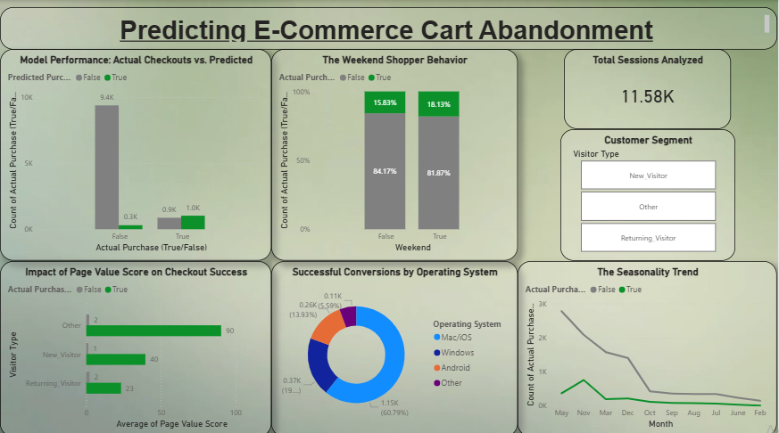

# 🛒 Predictive E-Commerce Cart Abandonment Analytics

## 🚀 Project Overview
Why do customers leave their carts without buying? This project provides a data-driven answer. Using **CRISP-DM** methodology, I built machine learning models in **IBM SPSS Modeler** to predict cart abandonment and translated the complex insights into an interactive **Power BI** executive dashboard.

## 💡 Key Business Insights
* **The Golden Metric:** Machine learning evaluation (C&R Tree) proved that **Page Value** is the absolute most important predictor of a successful checkout.
* **OS Matters:** Mac/iOS users drive the highest conversion volume (nearly 61% of successful purchases).
* **Strategic Timing:** Weekend and seasonal behavioral trends were mapped to help marketing teams optimize their ad spend timing.

## 🛠️ Tech Stack
* **IBM SPSS Modeler:** Data Cleaning, Feature Engineering, Predictive Modeling (C&R Tree, Logistic Regression, Neural Networks).
* **Microsoft Power BI:** Executive Storytelling, Interactive Data Visualization.

## 📁 Repository Contents
* `cart_abandonment_dashboard.pbix` - The interactive Power BI dashboard.
* `cart_abandonment_predictive_model.str` - The complete IBM SPSS Modeler stream.
* `Ecommerce_Scored_Output.csv` - The final scored dataset with model predictions.
* `Ecommerce_Cart_Abandonment_Project_Explanation.pdf` - The comprehensive visual report detailing the data audit, model splits, and evaluation metrics.
* `cart_abandonment_dashboard.pdf` - Static dashboard export for quick browser viewing.
